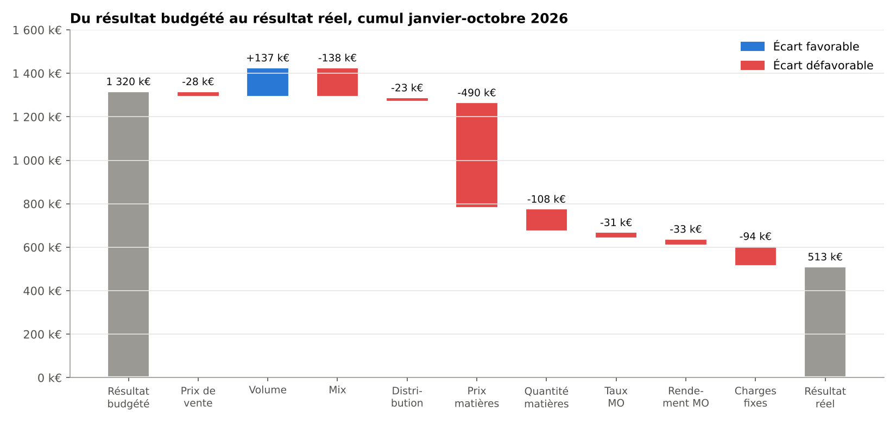
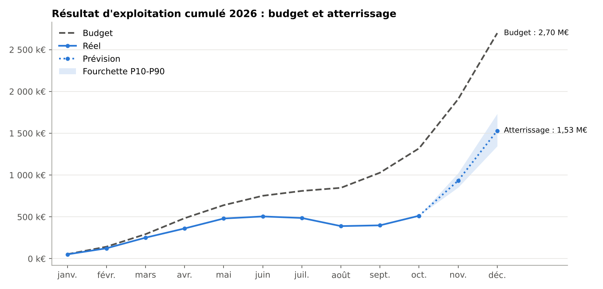
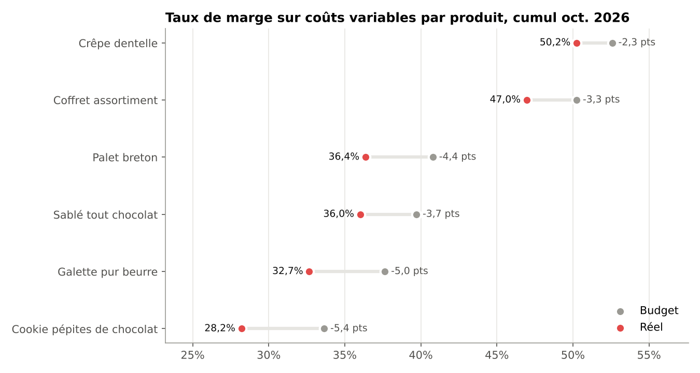
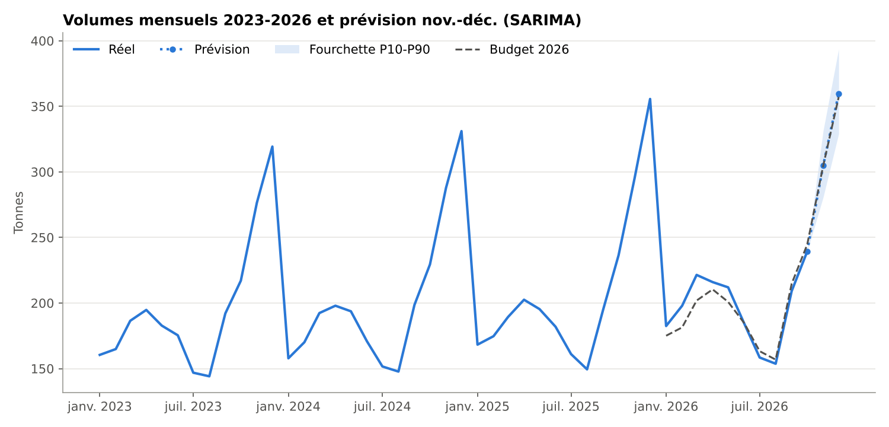
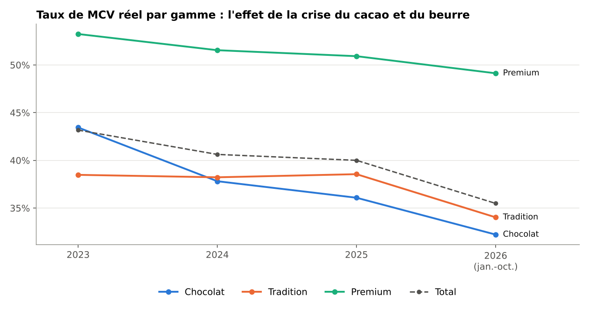

# Contrôle de gestion avec SQL et Python : pilotage budgétaire d'une biscuiterie

Outil de pilotage budgétaire d'une PME industrielle : base de données **SQLite**, analyse des écarts budget/réel **en SQL**, marges et seuil de rentabilité, **rolling forecast** par modèle statistique et **reporting Excel** avec commentaires automatiques.

> ⚠️ **Données 100 % fictives.** La société (Biscuiterie Ker Avel, 22 M€ de CA) et toutes ses données sont générées par le script `generer_donnees.py`. Aucune donnée réelle d'entreprise n'est utilisée.

## Résultats

| Indicateur (cumul janvier-octobre 2026) | Budget | Réel |
|---|---|---|
| Chiffre d'affaires | 16,22 M€ | 16,26 M€ (+0,2 %) |
| Taux de marge sur coûts variables | 40,0 % | **35,5 %** |
| Résultat d'exploitation | 1,32 M€ | **0,51 M€ (-61 %)** |
| Indice de sécurité | 20,4 % | 8,9 % |
| Point mort | 28 octobre | **non atteint au 31 octobre** |

**Le chiffre d'affaires est conforme au budget, mais le résultat chute de 61 %.** Le pont du résultat explique les 806 k€ d'écart, à l'euro près (écart de bouclage : 0,00 €). La première cause est la flambée des matières premières (-490 k€, dont -359 k€ sur le beurre). Viennent ensuite un mix de ventes dégradé (-138 k€) et des dépassements de charges fixes (-94 k€).

**Atterrissage 2026** (réel + prévision de novembre-décembre) : résultat de **1,53 M€ contre 2,70 M€ au budget (-43 %)**, dans une fourchette de 1,35 à 1,73 M€. Point mort projeté le 21 novembre, avec 24 jours de retard.







## Contexte

Le contrôle de gestion compare chaque mois le réel au budget, explique les écarts et réestime la fin d'année. Ce projet reproduit cette démarche sur une biscuiterie fictive : 6 produits répartis en 3 gammes, 3 canaux de vente (grande distribution, grossistes, export), 6 matières premières et 7 natures de charges fixes. L'historique couvre 46 mois (janvier 2023 à octobre 2026).

Pour vérifier que l'analyse retrouve les vraies causes, **14 événements ont été cachés dans les données de 2026** : flambée du beurre à partir d'avril, crise du cacao, promotion en grande distribution, perte d'un distributeur à l'export, panne d'une ligne de production, hausse des salaires, etc. Leur liste (`data/scenario_2026.csv`) sert uniquement de corrigé : les scripts ne la lisent jamais. **Les 14 événements ressortent de l'analyse**, avec le bon poste, le bon produit et le bon mois.

## Démarche

| Étape | Script | Rôle |
|---|---|---|
| 1 | `generer_donnees.py` | Crée la base SQLite (14 tables liées par des clés étrangères) : référentiel, nomenclatures, budget 2026, réel 2023-2026 |
| 2 | `analyse_ecarts.py` + `sql/ecarts.sql` | Calcule les écarts en SQL (8 vues) et construit le pont du résultat |
| 3 | `rentabilite.py` + `sql/rentabilite.sql` | Marges par produit et canal, seuil de rentabilité, point mort, sensibilité |
| 4 | `rolling_forecast.py` | Compare 3 modèles de prévision, prévoit novembre-décembre et calcule l'atterrissage |
| 5 | `reporting.py` | Reporting Excel de 7 onglets avec commentaires automatiques et graphiques |

### Analyse des écarts en SQL (étape 2)

La méthode est celle des coûts préétablis, sur budget flexible. Le chiffre d'affaires et la marge se décomposent par produit x canal, à l'aide de fonctions de fenêtrage SQL (`SUM() OVER (PARTITION BY ...)`).

| Écart | Formule |
|---|---|
| Prix de vente | (prix réel - prix budget) x volume réel |
| Volume | (volume réel total x mix budget - volume budget) x MCV standard unitaire |
| Mix | (volume réel - volume réel total x mix budget) x MCV standard unitaire |
| Prix des matières | (prix réel - prix standard) x quantité réelle |
| Quantité de matières | (quantité standard pour la production réelle - quantité réelle) x prix standard |
| Taux horaire | (taux réel - taux standard) x heures réelles |
| Rendement de la main-d'œuvre | (heures standard - heures réelles) x taux standard |
| Frais de distribution et charges fixes | standard ou budget - réel |

### Rentabilité (étape 3)

Les indicateurs calculés sont la marge sur coûts variables (par produit, par canal et par gamme de 2023 à 2026), le seuil de rentabilité, la marge et l'indice de sécurité, le levier opérationnel et le **point mort daté**, compte tenu de la saisonnalité. Une analyse de sensibilité chiffre l'effort nécessaire pour revenir au budget : **+5,3 % sur les prix de vente** ou +14 % sur les volumes.

### Rolling forecast (étape 4)

Trois modèles sont testés en **backtest** : chacun prévoit les 6 derniers mois clos à partir des données antérieures, sur 18 séries produit x canal.

| Modèle | WAPE | Biais |
|---|---|---|
| Naïf saisonnier (référence) | 8,6 % | +2,4 % |
| ETS (Holt-Winters amorti) | 10,0 % | +4,6 % |
| **SARIMA (1,0,0)(0,1,1)12** | **7,1 %** | +2,7 % |

Le modèle à la plus faible erreur est retenu automatiquement. Les volumes prévus, avec une fourchette P10-P90, sont valorisés aux derniers prix et coûts connus.



### Reporting (étape 5)

Le classeur Excel contient 273 formules (écarts, taux, cumuls, seuil de rentabilité) : il se recalcule si une donnée change. Les commentaires sont rédigés automatiquement pour chaque écart de plus de 25 k€, avec sa cause principale. Par exemple :

> *Prix des matières : -490 k€ (défavorable), dont beurre AOP -359 k€ (prix réel +10,3 % par rapport au standard) et chocolat de couverture -123 k€ (prix réel +8,4 % par rapport au standard). La dérive du beurre AOP commence en avril.*



## Livrables

- `data/biscuiterie.db` : base SQLite avec ses tables, ses vues d'analyse et les prévisions
- `resultats/reporting_2026-10.xlsx` : synthèse et commentaires, pont du résultat, écarts sur ventes et sur coûts, rentabilité, chronologie des écarts, atterrissage
- `resultats/graphiques/` : 6 graphiques au format PNG

## Utilisation

```bash
pip install -r requirements.txt
python lancer_controle.py
```

Les données sont reproductibles (graine aléatoire fixe). Pour explorer la base, on peut utiliser n'importe quel client SQLite (DB Browser for SQLite, extension SQLite Viewer de VS Code) : les vues `v_pont_mensuel`, `v_ecarts_ventes` ou `v_rentabilite` s'interrogent directement en SQL.

## Structure

```
├── data/
│   ├── biscuiterie.db           base SQLite (tables, vues, prévisions)
│   └── scenario_2026.csv        corrigé des événements cachés
├── sql/
│   ├── ecarts.sql               vues d'analyse des écarts
│   └── rentabilite.sql          vues de rentabilité
├── resultats/                   reporting Excel et graphiques
├── generer_donnees.py
├── analyse_ecarts.py
├── rentabilite.py
├── rolling_forecast.py
├── reporting.py
├── lancer_controle.py           lance les 5 étapes
└── requirements.txt
```

## Outils

SQL (SQLite, CTE, fonctions de fenêtrage) · Python · pandas · statsmodels · Matplotlib · openpyxl

## Pistes d'amélioration

- Tableau de bord interactif avec Streamlit ou Power BI branché sur la base
- Coûts complets par la méthode ABC et analyse de la gestion des stocks
- Prévision des prix des matières premières à partir de cours publics (beurre, cacao)

## Auteur

**Zakaria El Idrissi**, diplômé de Brest Business School (programme grande école), en préparation de l'expertise comptable.
[LinkedIn](https://www.linkedin.com/in/zakaria-el-idrissi-bbs)
